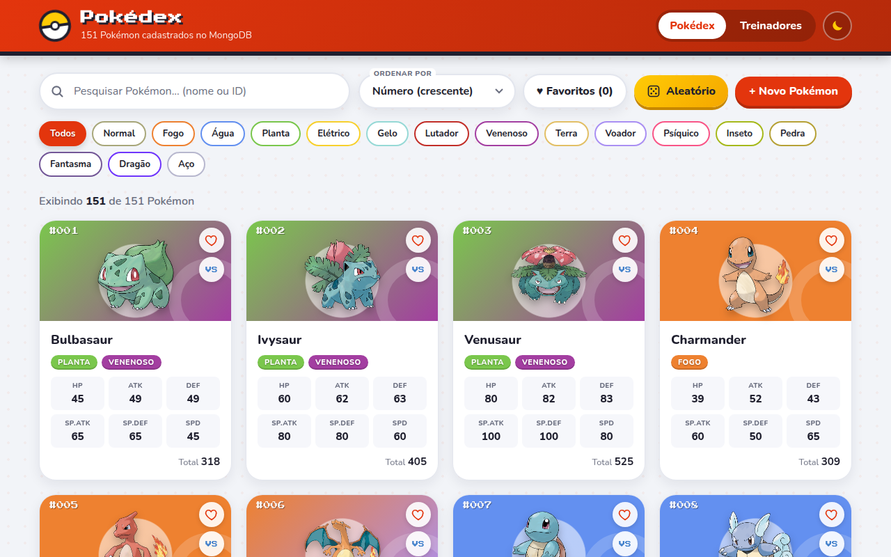
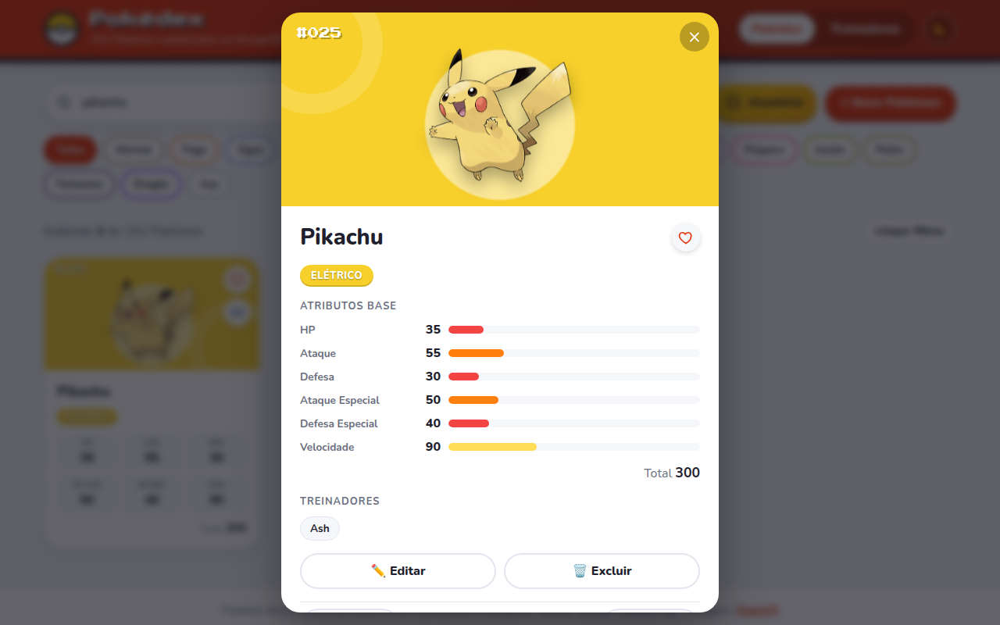
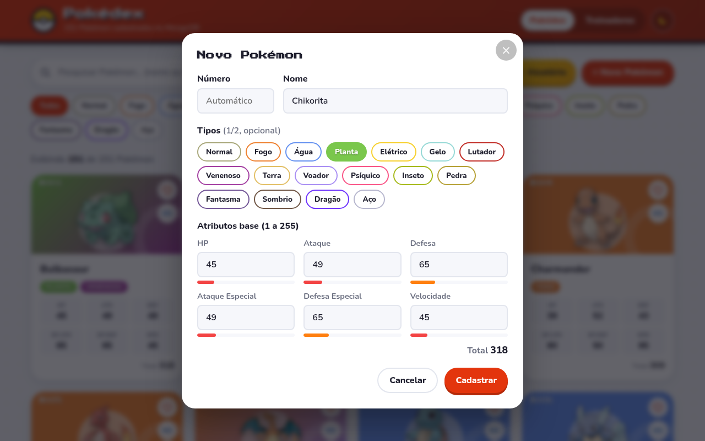
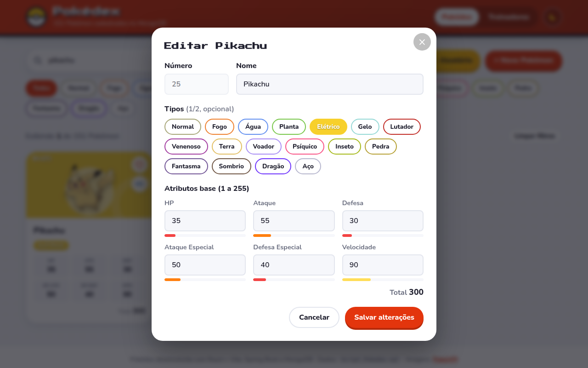
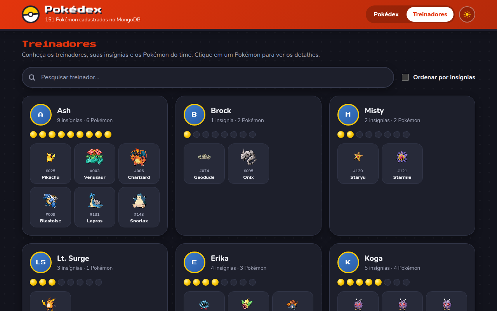
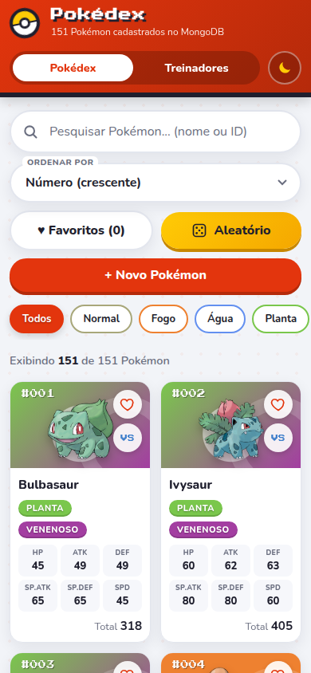

# 💾 Pokédex — React + Spring Boot + MongoDB

Atividade 04 da disciplina **Desenvolvimento e Integração de Aplicações Web**.

Esta atividade continua a [Atividade 03](https://github.com/afplinio/atividade-3-pokedex-diaw). A Pokédex em **React + Vite** deixou de ler o `pokedex-data.json` e agora consome uma **API REST em Spring Boot**. Os dados do `Script_Pokedex.sql` ficam guardados no **MongoDB**.

```text
Script_Pokedex.sql  →  MongoDB  →  Spring Boot REST API  →  React + Vite
```



## 👥 Integrantes

- Plínio Ferreira
- Ana Clara Freitas da Silva

## ✨ Funcionalidades

### Requisitos da atividade

- 🗄️ **MongoDB** populado automaticamente a partir do `Script_Pokedex.sql`: 151 Pokémon, 18 tipos e 12 treinadores.
- 🌐 **API REST** em Spring Boot com Controller, Service, Repository e Model.
- 🔎 **Pesquisa** por nome ou número e **filtro por tipo**. São os mesmos da Atividade 03, mas agora usam os dados vindos da API.
- 📄 **Detalhes** do Pokémon com barras de atributos e treinadores.
- ➕ **Cadastro** de Pokémon por um formulário com validação. O número é opcional: sem ele, a API usa o próximo disponível.
- ✏️ **Edição** pelo botão *Editar* no modal de detalhes.
- 🗑️ **Exclusão** com caixa de confirmação. O Pokémon também sai do time dos treinadores, dos favoritos e da comparação.
- ⏳ Estados de **carregamento** e de **erro**, com botão para tentar de novo. Também há **notificações** de sucesso e de erro.

### Desafios opcionais implementados

- 🧬 **Consulta por tipo** na API: `GET /api/pokemons?type=Fire`.
- 🔎 **Busca por nome** na API: `GET /api/pokemons?name=char`.
- 🧑‍🚀 **Treinadores persistidos** no MongoDB (coleção `trainers`).
- 🔗 **Relação treinador → Pokémon**: `GET /api/trainers/{id}/pokemons`.

Todas as funções da Atividade 03 continuam funcionando: favoritos, ordenação, comparação, Pokémon aleatório, tema escuro e layout responsivo.

| Detalhes | Cadastro |
| --- | --- |
|  |  |

| Edição | Treinadores (tema escuro) |
| --- | --- |
|  |  |

<p align="center"></p>

## 🗄️ Modelagem no MongoDB

O script SQL tem 5 tabelas. No MongoDB, as tabelas de relacionamento viram listas dentro dos próprios documentos, e ficamos com 3 coleções:

| Tabelas do `Script_Pokedex.sql` | Coleção | Documento |
| --- | --- | --- |
| `Pokemon` + `Rel_Pokemon_Type` + `Types` | `pokemons` | Atributos e lista com os nomes dos tipos |
| `Types` | `types` | `{ "_id": 5, "name": "Electric" }` |
| `Trainers` + `Rel_Trainer_Pokemon` | `trainers` | Insígnias e lista `pokemonIds` com o time |

Exemplo de documento da coleção `pokemons`:

```json
{
  "_id": 25,
  "name": "Pikachu",
  "hp": 35,
  "attack": 55,
  "defense": 30,
  "specialAttack": 50,
  "specialDefense": 40,
  "speed": 90,
  "types": ["Electric"]
}
```

Exemplo da coleção `trainers`:

```json
{ "_id": 1, "name": "Ash", "badges": 9, "pokemonIds": [25, 3, 6, 9, 131, 143] }
```

### Como o script é importado

1. No build, o Maven copia o `Script_Pokedex.sql` da raiz do repositório para o classpath da aplicação.
2. Na inicialização, o `DataSeeder` usa o `SqlScriptParser` para ler os comandos `INSERT INTO` e monta os documentos das três coleções.
3. A importação só roda quando a coleção `pokemons` está **vazia**. Assim, os cadastros e edições feitos pela API não se perdem ao reiniciar o backend.

Para recriar os dados originais do script, inicie o backend com `POKEDEX_SEED_RESET=true`.

> O Mew (#151) não tem tipo no script. Ele é salvo com `types: []` e aparece como **"Sem tipo"** no frontend.

## 🌐 API REST

URL base: `http://localhost:8080/api`

| Método | Endpoint | Descrição | Respostas |
| --- | --- | --- | --- |
| `GET` | `/api/pokemons` | Lista todos os Pokémon | 200 |
| `GET` | `/api/pokemons?name=pika&type=Electric` | Busca por nome e/ou tipo (opcionais) | 200 |
| `GET` | `/api/pokemons/{id}` | Busca um Pokémon pelo ID | 200, 404 |
| `POST` | `/api/pokemons` | Cadastra um Pokémon | 201, 400, 409 |
| `PUT` | `/api/pokemons/{id}` | Atualiza um Pokémon | 200, 400, 404 |
| `DELETE` | `/api/pokemons/{id}` | Remove um Pokémon | 204, 404 |
| `GET` | `/api/types` | Lista os tipos | 200 |
| `GET` | `/api/trainers` | Lista os treinadores | 200 |
| `GET` | `/api/trainers/{id}` | Busca um treinador | 200, 404 |
| `GET` | `/api/trainers/{id}/pokemons` | Pokémon do time do treinador | 200, 404 |

Corpo do `POST` e do `PUT`. O `id` só é usado no `POST` e é opcional.

```json
{
  "id": 152,
  "name": "Chikorita",
  "hp": 45,
  "attack": 49,
  "defense": 65,
  "specialAttack": 49,
  "specialDefense": 65,
  "speed": 45,
  "types": ["Grass"]
}
```

Regras de validação:

- `name` é obrigatório e tem no máximo 30 caracteres.
- Cada atributo é um inteiro de 1 a 255.
- Um Pokémon pode ter no máximo 2 tipos, e eles precisam existir na coleção `types`.

Em caso de erro, a API responde em JSON:

```json
{
  "status": 400,
  "error": "Bad Request",
  "message": "Dados do Pokémon inválidos.",
  "fields": { "hp": "O campo HP deve ser no máximo 255." }
}
```

📬 Para testar no **Postman** ou no **Insomnia**, importe [`docs/pokedex-api.postman_collection.json`](docs/pokedex-api.postman_collection.json). No VS Code (extensão REST Client) ou no IntelliJ, use [`docs/pokedex-api.http`](docs/pokedex-api.http).

## ▶️ Como executar

### Pré-requisitos

- [Java](https://adoptium.net/) 21 ou superior. Não é preciso instalar o Maven, porque o projeto usa o Maven Wrapper (`mvnw`).
- [Node.js](https://nodejs.org/) 20.19 ou superior, com npm.
- Um MongoDB: **MongoDB Atlas** (recomendado) ou **Docker**, para rodar localmente.

### 1. Clonar o repositório

```bash
git clone https://github.com/afplinio/diaw-atividade4.git
cd diaw-atividade4
```

### 2. Configurar o MongoDB

As credenciais **não ficam no GitHub**. O backend lê a conexão da variável de ambiente `MONGODB_URI`, que pode ficar em um arquivo `backend/.env`. Esse arquivo está no `.gitignore`.

```bash
cp backend/.env.example backend/.env
```

#### Opção A: MongoDB Atlas

1. Crie um cluster gratuito em [cloud.mongodb.com](https://cloud.mongodb.com/).
2. Em **Database Access**, crie um usuário com senha.
3. Em **Network Access**, libere o seu IP (ou `0.0.0.0/0` para testes).
4. Em **Connect → Drivers**, copie a *connection string* e cole em `backend/.env`:

```properties
MONGODB_URI=mongodb+srv://<usuario>:<senha>@<cluster>.mongodb.net/pokedex?retryWrites=true&w=majority
MONGODB_DATABASE=pokedex
```

#### Opção B: MongoDB local com Docker

```bash
docker compose up -d
```

O `backend/.env` copiado do exemplo já aponta para `mongodb://localhost:27017/pokedex`. Sem o arquivo `.env`, esse também é o valor padrão.

> Também é possível definir as variáveis direto no terminal, por exemplo `export MONGODB_URI="..."` (Linux/macOS) ou `$env:MONGODB_URI="..."` (PowerShell).

### 3. Rodar o backend (Spring Boot)

```bash
cd backend
./mvnw spring-boot:run        # Windows: mvnw.cmd spring-boot:run
```

A API sobe em **http://localhost:8080**. Na primeira execução, o log mostra `Script_Pokedex.sql importado: 151 Pokémon, 18 tipos e 12 treinadores.`

### 4. Rodar o frontend (React + Vite)

Em outro terminal:

```bash
cd frontend
npm install
npm run dev
```

Abra **http://localhost:5173/**. Se a API estiver em outro endereço, crie `frontend/.env` a partir do `frontend/.env.example` e ajuste `VITE_API_URL`.

### Variáveis de ambiente

| Variável | Onde | Padrão | Descrição |
| --- | --- | --- | --- |
| `MONGODB_URI` | backend | `mongodb://localhost:27017/pokedex` | Conexão com o MongoDB (Atlas ou local) |
| `MONGODB_DATABASE` | backend | `pokedex` | Nome do banco |
| `CORS_ALLOWED_ORIGINS` | backend | `http://localhost:5173,http://127.0.0.1:5173` | Origens do frontend liberadas no CORS |
| `POKEDEX_SEED_RESET` | backend | `false` | `true` apaga os dados e reimporta o script |
| `PORT` | backend | `8080` | Porta da API |
| `VITE_API_URL` | frontend | `http://localhost:8080/api` | URL da API usada pelo React |

### Testes do backend

```bash
cd backend
./mvnw test
```

São 13 testes: leitura do script SQL, regras do `PokemonService` e endpoints do `PokemonController`. Eles não precisam de MongoDB rodando.

## 🧩 Organização do projeto

```text
diaw-atividade4/
├── Script_Pokedex.sql             # Fonte dos dados (importada para o MongoDB)
├── docker-compose.yml             # MongoDB local (opcional)
├── docs/
│   ├── pokedex-api.postman_collection.json
│   ├── pokedex-api.http
│   └── screenshots/
├── backend/                       # Spring Boot 4 + Spring Data MongoDB
│   ├── pom.xml
│   ├── .env.example
│   └── src/main/java/br/com/pokedex/
│       ├── model/                 # Pokemon, PokemonType, Trainer (@Document)
│       ├── repository/            # Interfaces MongoRepository
│       ├── service/               # Regras de negócio (CRUD, busca, times)
│       ├── controller/            # Endpoints REST (/api/...)
│       ├── exception/             # Erros da API e @RestControllerAdvice
│       ├── seed/                  # SqlScriptParser e DataSeeder
│       └── config/                # CORS e conversor do MongoDB
└── frontend/                      # React + Vite (Pokédex da Atividade 03)
    ├── .env.example
    └── src/
        ├── api/                   # client.js (fetch) e pokedexApi.js (endpoints)
        ├── hooks/                 # usePokedexData, useToasts, useFavorites, useTheme
        ├── utils/                 # pokemonMapper.js (API ⇄ componentes), pokemon.js, sort.js
        ├── components/            # Componentes da Atividade 03 + PokemonForm, TypePicker,
        │                          # ConfirmDialog, LoadingState, ToastList
        └── App.jsx
```

### O que mudou no frontend

| Antes (Atividade 03) | Agora (Atividade 04) |
| --- | --- |
| `import data from './data/pokedex-data.json'` | Hook `usePokedexData` busca `/api/pokemons`, `/api/types` e `/api/trainers` em paralelo |
| Dados fixos | Lista atualizada após `POST`, `PUT` e `DELETE` |
| Sem carregamento | `LoadingState` e mensagem de erro com "Tentar novamente" |
| — | `PokemonForm` (cadastro/edição), `ConfirmDialog` (exclusão) e notificações |

A API guarda os atributos soltos no documento (`hp`, `attack`...) e os tipos só pelo nome. Os componentes da Atividade 03 usam `stats` e tipos como `{ id, name }`. O `pokemonMapper.js` converte de um formato para o outro, e por isso os componentes de listagem continuaram iguais.

## 🛠️ Tecnologias

- **Backend:** Java 21, Spring Boot 4.1 (Spring Web MVC, Spring Data MongoDB, Bean Validation), JUnit 5 e Mockito
- **Banco:** MongoDB (Atlas ou Docker `mongo:8.2`)
- **Frontend:** React 19, Vite 8 e CSS puro com variáveis

## ⚖️ Créditos

Pokémon e seus nomes são marcas registradas de Nintendo, Game Freak e The Pokémon Company. Projeto acadêmico, sem fins comerciais. Imagens: [PokéAPI](https://pokeapi.co/).
